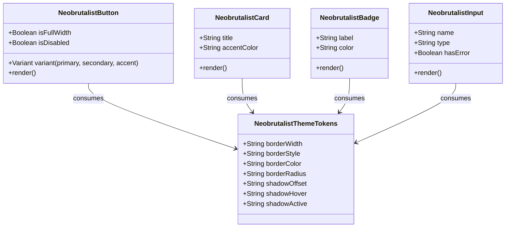

# Data & Token Model: Neobrutalism Design System

**Feature**: `001-neobrutalism-design-system`
**Date**: 2026-08-03

## Theme Tokens & Entities

### 1. Neobrutalist Design Tokens (`NeobrutalistThemeTokens`)

Represents the core styling rules and variables defining the Neobrutalism visual language.

| Token Identifier | Value / Value Range | Usage / Description |
|------------------|---------------------|---------------------|
| `--neo-border-width` | `3px` | Border thickness across cards, buttons, badges, inputs |
| `--neo-border-style` | `solid` | Border style |
| `--neo-border-color` | `#000000` (Light) / `#FFFFFF` (Dark) | Primary border color for high contrast |
| `--neo-border-radius` | `6px` (`4px`–`8px` range) | Corner radius for cards, buttons, badges |
| `--neo-shadow-offset` | `4px 4px 0px` | Un-blurred hard box shadow offset |
| `--neo-shadow-hover` | `6px 6px 0px` | Shadow offset on component hover state |
| `--neo-shadow-active` | `2px 2px 0px` | Shadow offset on component pressed/active state |
| `--neo-color-bg-canvas` | `#0b0f19` (Dark main) / `#F4F4F0` (Light canvas) | Main background color |
| `--neo-color-bg-card` | `#1e2b37` / `#FFFFFF` | Container / Card background color |
| `--neo-color-accent-yellow` | `#FEF08A` | High-energy yellow accent |
| `--neo-color-accent-pink` | `#FF70A6` | High-energy pink accent |
| `--neo-color-accent-purple` | `#A855F7` | High-energy purple accent |
| `--neo-color-accent-teal` | `#2DD4BF` | High-energy teal accent |

---

### 2. Neobrutalist UI Component Primitives (`NeobrutalistComponentSpec`)

Represents standardized UI components updated to use Neobrutalist design tokens.

---

## Validation & State Rules

1. **Contrast Rule**: Every text element rendered over an accent background MUST maintain a contrast ratio >= 4.5:1.
2. **Motion Rule**: Component translation on hover (`transform: translate(...)`) MUST NOT execute when `@media (prefers-reduced-motion: reduce)` is active.
3. **Corner Uniformity Rule**: Component border radius MUST adhere strictly to the `4px`–`8px` range set during clarification.
