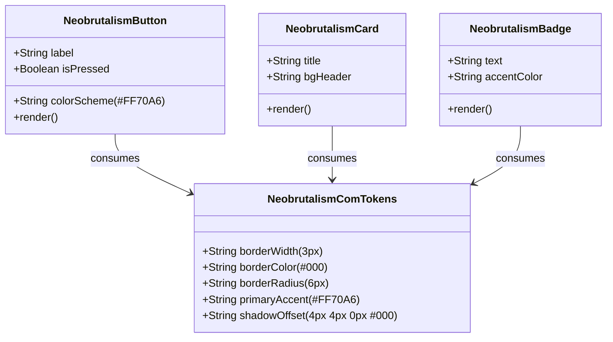

# Data & Token Model: Neobrutalism.com Component Design System

**Feature**: `002-neobrutalism-com-components`
**Date**: 2026-08-03

## Theme Tokens & Entities

### 1. Neobrutalism.com Theme Tokens (`NeobrutalismComTokens`)

Represents the core styling rules and design variables derived from neobrutalism.com.

| Token Identifier | Value / Value Range | Usage / Description |
|------------------|---------------------|---------------------|
| `--neo-border-width` | `3px` | Border thickness across cards, buttons, badges, inputs |
| `--neo-border-style` | `solid` | Border style |
| `--neo-border-color` | `#000000` | High-contrast black border |
| `--neo-border-radius` | `6px` | Standard corner radius for cards, buttons, badges |
| `--neo-shadow-offset` | `4px 4px 0px #000` | Un-blurred hard box shadow offset |
| `--neo-shadow-hover` | `6px 6px 0px #000` | Shadow offset on hover state |
| `--neo-shadow-active` | `2px 2px 0px #000` | Shadow offset on active/pressed state |
| `--neo-color-accent-primary` | `#FF70A6` (Electric Pink) | Primary signature accent color |
| `--neo-color-accent-yellow` | `#FEF08A` | Supporting yellow accent |
| `--neo-color-accent-teal` | `#2DD4BF` | Supporting teal accent |
| `--neo-color-accent-purple` | `#A855F7` | Supporting purple accent |
| `--neo-color-bg-canvas` | `#0b0f19` | Main background canvas |
| `--neo-color-bg-card` | `#1e2b37` | Card / container background |

---

### 2. Neobrutalism.com UI Primitives Diagram

---

## Validation & Accessibility Rules

1. **Primary Accent Rule**: Primary call-to-action buttons and active navigation links MUST use Electric Pink (`#FF70A6`) with black text for high contrast.
2. **Motion Guard**: Hover and active translation transforms MUST be disabled under `@media (prefers-reduced-motion: reduce)`.
3. **Contrast Ratio**: All text/background contrast combinations MUST pass WCAG 2.2 AA standards (minimum 4.5:1 ratio).
